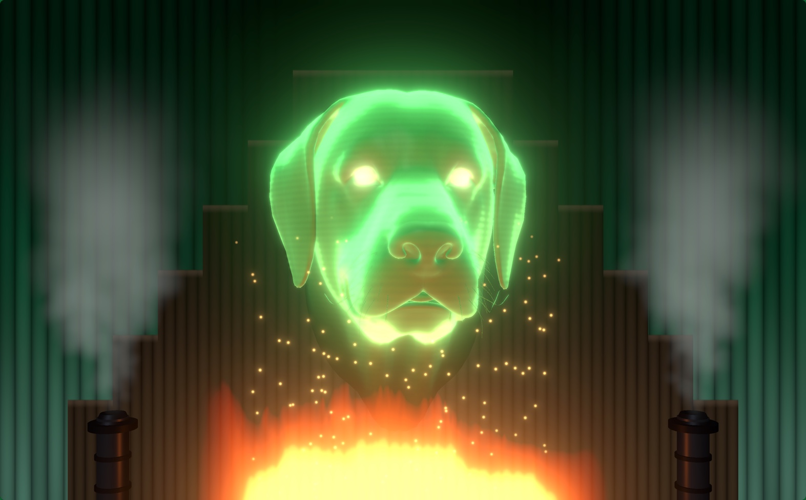

# The Great Oz(zie)

Every year for Halloween night, we do a haunted house in our garage for the kids to walk through. This year's theme is the Wizard of Oz. For that, I created this effect:

A projected green head over a fire, with steam on both sides. A hidden performer talks into a mic. The app lowers the voice, adds a large-hall reverb, and plays it through the room speakers. The jaw follows the processed voice. A presentation clicker or a phone triggers fire flares, steam bursts, and lightning with thunder.

There are a couple of head designs availalbe, some of which are tunable. We went with a Labrador Retriever, since our Lab is named **Ozzie**.



## Use of AI Coding Tools

This package was developed using Claude Code and Claude Opus 5.5.

## Run it

Rehearse in dev mode:

```sh
npm install
npm run dev
```

Open `http://localhost:8787/` in Chrome. Then click, or press a clicker button such as PageUp, PageDown or `b`, to start. Chrome won't start sound, the mic or fullscreen until someone clicks or presses a key, and that first press only starts the show. Show mode starts without this step. Add `?demo` to drive the mouth with fake speech and no mic.

For the show, connect the projector and run:

```sh
WIZARD_DISPLAY_X=1920 npm run show
```

Set `WIZARD_DISPLAY_X` to any x coordinate on the projector's display, from System Settings > Displays. The script builds the app, starts the server, and opens Chrome in kiosk mode on that display. Quit with Cmd+Q. Stop `npm run dev` first, because both use port 8787.

## Controls

| Key | Action |
| --- | --- |
| `PageDown`, `Right arrow`, `1` | Fire flare |
| `PageUp`, `Left arrow`, `2` | Steam burst. Four quick taps strike lightning |
| `b`, `.`, `3` | Random dog trick |
| `F5`, `Esc` | Mute or unmute the mic |
| `s` | Setup panel |
| `m` | Move the setup panel between its corner and the center of the screen |
| `f` | Back to fullscreen |
| `u` | Flip the picture upside down |
| `k` | Show or hide the keystone handles |
| `a` | Play the last dog trick again, for testing |
| `n` | Play the next autopilot trick, for testing |
| `r` | Reset the keystone, while the handles show |
| `c` | Pull the keystone corners in to a quarter of the way from each edge, while the handles show |

Most presentation clickers send PageUp and PageDown. Their third button sends `b` or `.`. The setup panel shows the last key pressed. If your clicker sends something else, add the key to `KEY_MAP` in `src/config.ts`, or to `MIC_TOGGLE_KEYS` for muting.

Many clickers also have a "start show" button that sends F5 and Esc in turn. Each press mutes or unmutes the mic, so it works as a mute button. Muting silences the voice and closes the mouth, and any reverb already playing dies out. While muted, the wizard's eyes dim to a faint glow, so you can see the state from behind the curtain. The phone remote and the setup panel show it too, and the remote can toggle it. The mic starts muted every time the app starts, so unmute when you're ready to speak.

Unmuting takes effect after a tenth of a second. Sound reaches the app late, by 10–20 ms with a wired mic, so the wait keeps your last words before unmuting from leaking out. The eyes brighten when the mic actually opens, so wait for them before you speak. AirPods add about 0.2 seconds of Bluetooth delay. If you use them, set `unmuteHoldSec` in `src/config.ts` to 0.35.

The app stops F5 from reloading the page. In fullscreen it also locks the Esc key, so only holding Esc for about 2 seconds leaves fullscreen. Press `f` to go back. In show mode Chrome runs in kiosk mode, where Esc never leaves fullscreen.

A loud shout also flares the fire, at most once every 2 seconds.

A clicker has only three buttons, so lightning hides behind the steam button. Tap steam four times, with less than 0.6 seconds between taps. The first three taps blow steam, and the fourth strikes lightning with thunder. To change the count or the gap, edit `STEAM_TAPS_FOR_LIGHTNING` and `STEAM_TAP_GAP_SEC` in `src/config.ts`.

## Dog tricks

Each press of the trick button plays one of these tricks at random. It never picks any of its last four picks. To change that count, edit `TRICK_NO_REPEAT` in `src/config.ts`.

- Treat: a dog biscuit balances on the nose while a clock ticks, and the head trembles with the effort of waiting. Then it flips the biscuit up, catches it, and crunches it, scattering crumbs.
- Wizard: "We're off to see the Wizard" on a kazoo, over an oom-pah bass. The head bobs side to side on the beat, the ears flap, and it lifts its nose on the last note.
- Rainbow: a rainbow arcs across the sky behind the dog as a music box plays "Somewhere over the rainbow, way up high". The dog gazes up dreamily, and one ear rises on "way up high".
- Doorbell: a "ding-dong" from one side. Both ears shoot up, the head snaps toward the door, and the dog gives two happy "boof"s and a hopeful tilt.
- Firefly: a glowing firefly buzzes in and loops around the dog's face, and the head follows it. Snap! Gulp. The muzzle blinks from inside like a lantern, then a burp lets out a puff of sparks.
- Pumpkin: the head turns into a grooved orange jack-o'-lantern. A match strikes, and a candle lights inside the mouth and eyes. The dog grins, then blows its own candle out.
- Shake: a wet-dog shake that flings water drops off its ears and head, with flapping ears and a jingling collar tag. The water puts the fire out with a hiss and a puff of steam, and it relights a moment later.
- Sneeze: rears back twice, then sneezes "choo!" so hard the steam vents blast a cloud wider than a normal burst.
- Colors: "a horse of a different color." The head turns purple, yellow and red, then green again, with a harp sweep at each change.
- Howl: swings its nose up toward the sky while turning to a random side, then howls as the fire flares.
- Squirrel: snaps its head to the side and leans in, stretching its neck, and stares. It can play a clip first, as described below.
- Bubble: blows a pink chewing-gum bubble that grows with each breath and pops in its face, scattering bits of gum.
- Ghost: fades into a pale, see-through ghost with glowing eyes and drifts up, with a theremin "wooOOoo", then comes back.
- Vampire: the head lowers, then rises with blood-red eyes and the upper canines growing into long fangs, to the opening of Bach's Toccata and Fugue in D minor on a pipe organ.
- Monkeys: flying monkeys swoop across the stage in front of the dog, screeching. The dog looks up and follows them, mouth open.
- Spin: turns its head all the way around, like a possessed doll.

Two tricks are benched. Their code stays, but the trick button and autopilot never pick them. To check one, use `?trick=lunge` or `?trick=melt`, described below. To bring one back, remove `benched: true` from it in `src/display/tricks.ts`.

- Lunge: a jump scare. The head rears back, then lunges at the audience with a "WOOF!" as the lightning strikes.
- Melt: the witch cries "Look what you've done! I'm melting! Melting!" as the head writhes and drips down into a puddle in clouds of steam. It lies there through "Oh, what a world", then rises back up whole.

These play only on autopilot, never from the trick button. See Autopilot below.

- Lick: licks its nose with one swipe across and back, with a slurp.
- Tilt: the confused head tilt, to a random side, with a questioning whine.
- Pant: pants happily with its tongue hanging out.
- Hiccups: four little jolts at uneven intervals, each with a "hic!".
- Wink: both eyes flare bright, then one goes dark for a moment, with a sparkle.
- Nap: the poppy field. Twice the head sinks and lolls to one side, then jerks partway back up. The third time it stays down, snoring with "Z"s rising, then wakes with a snort.
- Perk: an owner's whistle from one side. The ear on that side springs straight up with a "boing", and the head turns and tilts toward the sound, listening. Then the ear flops back down.
- Scratch: a scratch in the sweet spot behind one ear. The head leans into it with its eyes shut, that ear lifts a little, and the scratching goes "shhhh" faster and faster.
- Blep: the tongue thrusts out once and goes straight back in.

A trick takes 1.2 to 7.8 seconds. Pressing again during a trick starts the next one at once, and the last trick's sounds fade out in about a tenth of a second. Unmuting the mic stops any trick: the head returns to rest in 0.3 seconds, and the trick's sounds fade out. Fire, steam and lightning carry on. The performer can keep talking during a trick, but tricks that open the mouth take over the jaw while they run.

Only the Labrador has a tongue, canine teeth and ears that lift, so the other heads skip perk, doorbell, blep, lick, pant and vampire. Only the Labrador has the top of its nose measured, so only it does the treat. The model has no back to its skull. During the spin, the inside of the head is painted a smooth green, so the back reads as solid.

To check a pose, add `?trick=lick&at=0.8` to the URL. It holds that trick at 0.8 seconds in.

The squirrel trick can start with a sound clip, such as Dug's "Squirrel!" from the movie *Up*. Save the clip as `public/sfx/squirrel.mp3` or `public/sfx/squirrel.wav`. The dog plays the clip, then turns its head when the clip ends. Trim any silence from the end of the clip, or the turn comes late. Without the file, the squirrel trick plays its own short sound and turns at once.

The melt plays the witch's lines from `public/sfx/melt.wav`, in place of its own sound. The melt is timed to that clip: the head starts melting at "I'm melting!", 1.3 seconds in, and re-forms after 7.4 seconds, when she finishes. A different clip needs new times in `MELT_LINES` and the melt trick in `src/display/tricks.ts`. Without the file, the melt plays a synthesized sizzle and wail on the same timeline.

The hiccups use recorded "hic"s from `public/sfx/hic-1.wav`, `hic-2.wav` and so on, numbered from 1 with no gaps. Each jolt plays one at random, never the same one twice in a row, a little faster or slower each time. Each file must start right at the sound, so it lands on the jolt. Without the files, the hiccups use a synthesized "hic".

The nap snores with recordings from `public/sfx/snore-1.wav`, `snore-2.wav` and so on, numbered the same way, and wakes with a snort from `public/sfx/snort-1.wav` and so on. Each snore and snort plays one of its files at random, never the same one twice in a row. Each file should start close to its sound. Keep snores under 1.2 seconds, since the nap snores once every 1.2 seconds. Without the files, the nap uses a synthesized snore and snort.

### Autopilot

When nobody presses a button and nobody speaks for 45 seconds, the dog does a small trick on its own: lick, tilt, pant, hiccups, wink, nap, perk, scratch or blep. These play only on autopilot, never from the trick button. To test them, press `n`. Each press plays the next autopilot trick in order. It never repeats the trick it just did, and the wait varies by up to 30% so the tricks don't come like clockwork. Autopilot never plays the big set pieces, such as the monkeys, ghost or spin. Those stay under your control. Set the wait with the Autopilot slider in the setup panel. 0 turns autopilot off. Autopilot tricks don't count as trick-button picks.

## Upside-down projector

If the projector mounts better upside down, press U. The whole page turns 180°, including the setup panel. Press U again to turn it back. The flip saves with the other settings.

The flip costs no frame rate or sharpness. Most projectors also have a ceiling-mount setting that flips the picture. If yours has one, use it instead of U. The mouse pointer on the wall then moves the right way too.

If you use both U and keystone correction, flip first, then drag the corners. Pressing U later turns the corrected shape around too, so it no longer fits the wall. While you drag, the mouse pointer on the wall moves the opposite way to your hand. The projector shows the Mac's own pointer upside down.

## Keystone correction

If the projector sits off-angle, the picture on the wall is a tilted shape instead of a rectangle. To correct it:

1. Press K. A red handle appears in each corner of the picture.
2. Drag each handle until that corner of the picture sits where you want it on the wall.
3. Press K again to hide the handles.

To go back to the uncorrected picture, press K, then press R.

If the screen crops its edges, you can't see the handles in the corners. Press K, then press C. The corners move to a quarter of the way in from each edge, so you can see all four. Then drag them out to the wall's corners. If the setup panel is cut off too, press M to move it to the center of the screen. Press M again to move it back.

The corners save with the other settings, so they survive a reload and a server restart. They're fractions of the screen, so they also survive a change of resolution. The lightning flash follows the corrected shape, so it never lights the wall outside the picture.

The correction costs no frame rate. Any correction softens the picture a little, and the narrowed side loses some resolution. If you can, aim the projector straight instead. An uncorrected picture is pixel-exact.

## Phone remote

The server prints the remote URL at startup, and the setup panel shows it too. It looks like `http://<mac-name>.local:8787/remote.html`. The phone must be on the same Wi-Fi as the Mac. If the page says "offline", the Wi-Fi probably blocks device-to-device traffic. In that case, join the Mac to the phone's hotspot.

The remote has buttons for fire, steam, lightning, dog tricks and the mic, and sliders for volume, effects volume, fire level and overall brightness.

If audio fails during the show, a red message appears in the bottom-left corner. It clears itself after 10 seconds.

## Setup panel

Press `s` to open it.

- **Overall brightness:** dims the whole picture, effects and lightning included, if the projection is too bright. Black stays black, and the setup panel stays readable.
- **Mic and Speakers:** pick the mic and the room speakers. Always pick the speakers explicitly. If you don't, macOS can move the output onto the AirPods when they become the input.
- **Cue tones:** where the mute and unmute tones play. Pick the performer's AirPods, and only the performer hears them: two falling notes for muted, two rising notes for live. The voice and effects stay on the speakers. Off plays no tones. The unmute tone plays while the mic is still shut, so the mic can't pick it up.
- **Test speakers:** plays a short beep through the chosen output. If one speaker stays silent while others work, open Audio MIDI Setup and check that device's volume and Mute box. macOS keeps a separate volume for each device, and the menu-bar slider only changes the current default.
- **Autopilot after:** seconds without a button press or speech before the dog does a small trick on its own. 0 turns autopilot off. See Autopilot under Dog tricks.
- **Effects volume:** turns down the fire, steam and thunder sounds and leaves the voice alone. Set the voice with Volume first, then lower the effects to taste. At 1 the effects play at full level.
- **Pitch and Reverb:** shape the voice. Pitch 0.72 is about six semitones down.
- **Gate:** silences the mic below this level. Raise it if room noise makes the mouth twitch. Keep it below your quietest words, or it chops the voice mid-sentence. 0.004 suits the wired mic at its current input level.
- **Mouth sensitivity:** the voice level that opens the jaw fully. Watch the meter while you speak normally. Aim for about half.
- **Head scale and height:** fit the head to the screen or scrim.
- **Shine:** strength of the glossy highlight on the head. 0 is fully matte.
- **Rim glow:** strength of the green glow around the head's outline. 0 turns it off.
- **Organ backdrop:** draws the pipe organ from the film's throne room behind the head: a stepped case of fire-lit pipes between glowing green columns, with dark silver steam pipes under the steam vents. The organ pipes brighten when the fire flares. 0 turns it off and leaves the background black, which a scrim or Pepper's ghost needs.
- **Oz sculpt:** shown only when the Oz head is selected. One slider per distortion of the Oz head: dome width, start and height, forehead ridges, brow, eye sockets, nose, cheek folds, jaw taper, chin drop, feature size and feature height. Dome start sets how low on the face the widening begins. Lower values widen the cheeks and jaw too. Feature size scales the eyes, nose and mouth together without changing the head outline, and Feature height moves them up or down. Every other slider at 0 turns its distortion off. Reset restores the defaults.

Settings save in the browser. The show profile in `.chrome-show-profile` keeps its own copy, so tune in show mode.

## Mic notes

AirPods add about 150–250 ms of Bluetooth delay. You will hear your own voice boom back late, which can make you stumble over words. Noise cancellation helps. A wired or USB mic cuts the delay to about 10 ms. The mouth stays in sync either way, because it follows the speaker output and not your voice.

The app cuts everything below 120 Hz from the mic, before the pitch shift and bass boost. This cut removes the rumble of breath and plosives hitting the mic, which a wired mic picks up more than AirPods do. The gate silences mic noise between words. But noise under your voice still plays, and the reverb carries it for a moment after you stop. If you still hear a buzz while you speak, it comes in with the mic signal. Keep the mic cable away from power cables and the projector.

## Sound effects

Each trigger plays a sound through the speakers: a whoosh with crackles for the fire, a two-vent hiss for the steam, and thunder for the lightning. Each dog trick plays its own sound. Fire flares set off by a shout stay silent, so they don't cover the voice. The Effects volume slider, in the setup panel and on the phone remote, turns all of these down together.

The app synthesizes all three sounds. To use a recording instead, save it as `public/sfx/fire.wav`, `steam.wav`, or `thunder.wav`.

## Credits

Head scan: "Infinite" by Lee Perry-Smith, CC BY 3.0, from the three.js examples. See `public/models/LeePerrySmith_License.txt`.

Labrador: ["Dog"](https://sketchfab.com/3d-models/dog-06d4813d176e4beb99d2f051d61fd865) by all of life, CC BY 4.0, from Sketchfab. See `public/models/dog_License.txt`.
